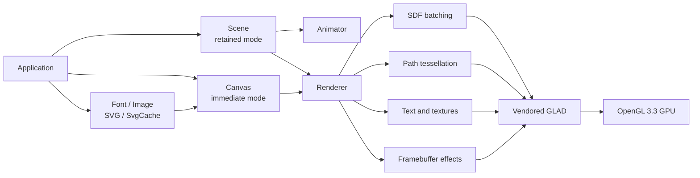
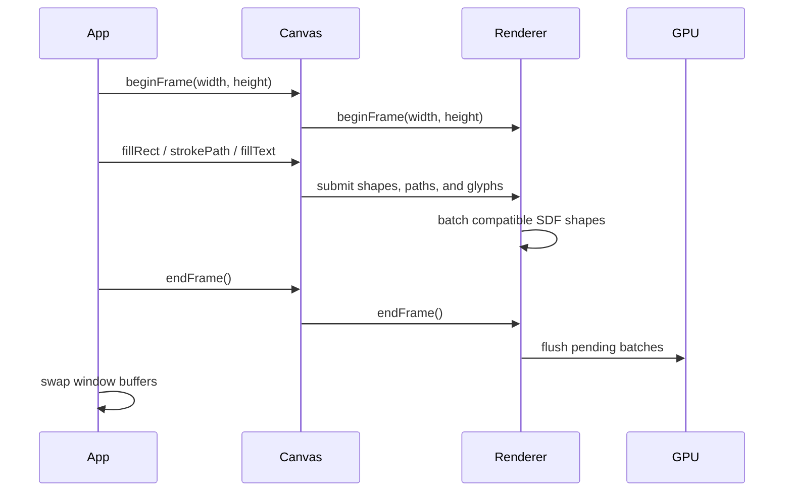

# VectorGL Architecture and Code Flow

This document explains how VectorGL's public APIs, scene graph, asset loaders,
renderer, shaders, and OpenGL resources fit together.

## System overview



VectorGL provides two front ends over one renderer:

- `Canvas` is immediate mode. The application submits drawing operations every
  frame and controls their order directly.
- `Scene` is retained mode. Nodes preserve geometry, style, transforms,
  hierarchy, effects, and animation state between frames.

Both routes eventually submit work to `Renderer`.

## Optional application input layer

The default-enabled `vectorgl::ui` static target adds a host-independent Context over
registered widget descriptors. It manages identity, focus scopes, event bubbling,
capture, cancellation, deferred removal, and invalidation/deadlines. It neither
creates a window nor initializes OpenGL; it does not use Scene picking for UI hits.
Widgets use application-supplied local rectangles and composed affine transforms.
Inverse mapping drives pointer coordinates and ancestor clip hit tests. Painting
uses the same transforms and order, with modal subtrees raised in stack order.
`WidgetPainter` strategies receive a scoped `PaintContext` and a shared Theme;
application callbacks retain editing/activation behavior. Exact transformed sharp
rectangular masks use stencil triangles, preserving shear and reflections.

Optional immutable `Layout` strategies implement headless measure/arrange for rows,
columns, and explicit grids. Intrinsic callbacks receive constrained sizes and Theme.
Context stages placement before publishing local bounds/offsets; placement composes
before application transforms in both painting and hits. It retains at most four
measurements per widget, with revision-based invalidation and an unchanged-root fast
path. Measurement callbacks cannot mutate Context. See [layout](docs/ui-layout.md).

`SplitPanel` and `ScrollView` own registered widget subtrees through small controllers.
Their layout strategies remain immutable; shared private state connects painting,
input, and geometry notifications without coupling Context to specific controls.
`ScrollModel` contains host-independent bounded geometry. Scroll transforms preserve
layout caches; residual wheel deltas bubble only through UI ancestors, and focused
descendants reveal from inner to outer views. See [containers](docs/ui-containers.md).

Routed control controllers share state between input and polymorphic painters.
TextField reuses TextBox's codepoint editing model and separates the buffer from
the committed value. NumericEditor composes a field and step buttons with an
injectable parse/format policy. Context owns focus/capture; controls own activation,
validation, completion, and caret deadlines. Shared theme state colors apply to
buttons, checkbox/toggle surfaces, and editors. See [controls](docs/ui-controls.md).

OverlayManager owns transient registered subtrees. ScrollView-backed popup lists
and dialogs use Context modal scopes for input isolation and focus restoration;
display-only tooltips use a raised, pointer-transparent layer and injected-clock
deadlines. Placement is in root logical coordinates and updates at the host's
layout/input boundary. ComboBox reuses the shared activation strategy and manager
instead of introducing another event router. See [overlays](docs/ui-overlays.md).

Workspace controls compose the same registered primitives. TabBar uses a roving
sequential Tab stop, while TabView owns page visibility and focus handoff.
CollapsibleSection hides its body through Context, inheriting cancellation and
timer cleanup. SearchField reuses TextField and an explicit clear action; filtering
remains application policy. Label performs constrained measurement and cached
codepoint-safe ellipsis; display-only labels/separators are pointer-transparent.
See [workspace controls](docs/ui-workspace-controls.md).

ListView composes a fixed-size registered subtree with ScrollView and a visible-row
painter. Immutable ListModel snapshots supply stable item IDs; replacement builds
ID/enabled indices once and reconciles selection/current state by identity.
Scrolling, input targeting, and painting operate on cached geometry and visible
rows rather than per-item widgets. The default text painter and app-defined
ListRowPainter strategies share row/ancestor clipping and Canvas state isolation.
See [virtualized lists](docs/ui-lists.md).

TreeView indexes an immutable TreeModel forest once, validates identity/parent
relationships through iterative traversal, and projects expanded nodes into the
existing ListView. A weakly bound row painter and input filter add indentation,
disclosures, and hierarchy navigation without a second selection/scroll engine or
per-node widgets. Projection changes reconcile current/expansion state by identity;
revision checks suppress obsolete notifications after callback-driven changes.
See [virtualized trees](docs/ui-trees.md).

TableView composes the same ListView with a fixed, separately focused header and
cached column edges. A TableModel adapter preserves row identity while cell painters
query only viewport rows/intersecting columns. Header hit testing and rendering use
the body's actual viewport and horizontal offset. Sorting remains an application
callback; resizing changes shared column geometry without reindexing row data.
Cancellation restores the old width before publishing replacement columns, even
when Context defers cleanup delivery. See [virtualized tables](docs/ui-tables.md).

Context owns typed in-process drag sessions alongside pointer capture. Drag target
resolution reuses clipping/modal/overlay hit traversal; owned payloads and retained
registration storage keep cancellation/removal notifications safe. Sessions consume
source gestures, reset source press state, and finish once after target cleanup.
See [drag/drop](docs/ui-drag-drop.md). Collection projections carry a complete
enabled-ID universe so hidden selection survives filtering/collapse independently
of visible current/focus. The integrated public-API workspace exercises these
contracts; see [milestone 10 validation](docs/ui-editor-workspace.md).

Registrations have context-scoped generation IDs. Callback storage stays alive
until dispatch settles, including cancel/lost-focus delivery for removed widgets.
The model is bound to one UI thread. Platform services and clocks are injectable,
and optional package discovery exports `vectorgl::ui` only on request.
See [UI Context](docs/ui-context.md) for routing and failure contracts.
The optional `vectorgl::glfw` adapter translates explicitly forwarded host events,
provides window/framebuffer/content-scale conversion, and supplies clipboard/cursor
services. It owns neither native callbacks nor the window/context. Package components
keep UI-only discovery independent of GLFW. See [host integration](docs/ui-glfw.md).

`FileDialogService` queues injected backend work and completes it outside Context
transactions. Before native entry it cancels gestures and creates a modal barrier;
host events drain under that barrier before eligible focus is restored. Generation
IDs revalidate bound owners before completion. Active cancellation suppresses late
results but does not close a blocking native chooser. Optional `vectorgl::dialogs`
provides Windows COM and Linux Zenity backends independently of GLFW. See
[file dialogs](docs/ui-file-dialogs.md) and [migration gates](docs/ui-migration.md).

## Main classes

| Class | Responsibility | Owns GPU resources |
|---|---|---:|
| `Canvas` | Drawing state, transform and clip stack, paths, text, images, and frame API | Through `Renderer`, fonts, and images |
| `Scene` | Node ownership, traversal, world-transform updates, and rendering | No |
| `Node` | Persistent geometry, style, transform, children, and effects | No |
| `Animator` | Tween, spring, and keyframe progression | No |
| `Renderer` | Batching, shaders, buffers, textures, framebuffers, and draw submission | Yes |
| `Path2D` | Path commands and curve tessellation inputs | No |
| `Font` | TrueType data, glyph metrics, and texture atlas | Yes |
| `Image` | Decoded raster image and OpenGL texture | Yes |
| `SvgImage` | Parsed SVG document and render commands | Indirectly |
| `SvgCache` | Reusable SVG asset handles | Indirectly |
| `TextBox` | Editing, selection, caret, and text layout state | No |
| `GlfwTextBoxController` | Optional GLFW input adapter for `TextBox` | No |

## Immediate-mode frame flow



`beginFrame()` resets Canvas drawing state and establishes framebuffer
dimensions. SDF primitives are accumulated and flushed when the batch fills,
rendering state changes, an effect begins, or the frame ends.

Clipping is part of Canvas state. `clipRect()` transforms the four corners,
intersects the resulting axis-aligned bounds with any existing clip, and sends
the result to Renderer as an OpenGL scissor rectangle. `clipRoundedRect()`
adds an exact SDF-shaped mask to a nested stencil stack and also contributes a
coarse scissor bound. Restoring Canvas state rebuilds that stack, so sibling
clips cannot inherit stale stencil values.

Changing clip state flushes pending SDF instances first, preserving command
order. Effect passes temporarily disable scissor and stencil tests while
capturing off-screen content and restore both before compositing. Applications
using rounded clipping must request a stencil buffer for their default
framebuffer; the examples use `glfwWindowHint(GLFW_STENCIL_BITS, 8)`.

## Retained-mode scene flow

1. The application creates nodes through `Scene`.
2. Parent-child relationships establish transform inheritance.
3. `Animator` updates properties using frame delta time.
4. `Scene::update()` resolves world transforms and dirty state.
5. `Scene::render()` traverses visible nodes.
6. Each node submits its geometry and style to `Renderer`.
7. Nodes with effects are captured into an off-screen framebuffer before
   blur, shadow, or glow compositing.

Scene nodes do not own OpenGL objects. This keeps scene mutation separate from
GPU resource lifetime.

## Rendering paths

### SDF primitives

Rectangles, rounded rectangles, circles, and ellipses use signed-distance-field
shaders. `Renderer` stores compatible shapes in an instance buffer and renders
them together.

### Complex paths

`Path2D` records commands and approximates curves with line segments. All fill
contours are tessellated together by libtess2 (fetched from a pinned, hash-verified archive), using `FillRule::NonZero`
or `FillRule::EvenOdd`. This resolves holes, overlaps, and self-intersections
before upload, without consuming stencil bits. Antialias fringes are generated
only along exposed mesh boundaries, in framebuffer pixels. Picking uses the
same rule; boundary hits resolve against the filled mesh. Stroke segments, joins
and caps form positively wound polygons, which are unioned with the same
tessellator before drawing. This prevents repeated alpha blending at overlaps.
Strokes preserve explicit closure instead of implicitly closing open contours.
Dash patterns split each subpath by local arc length along its sampled segments.
Odd patterns repeat twice; zero-length dashes retain tangent information for
square caps. Wrapped runs are joined at closed seams, and interval work is
bounded. All visible runs then enter the existing stroke union/tessellation step.
Round joins and caps use bounded local-space sampling. Path/line picking tests
the same stroke mesh used for rendering. Canvas stroke settings are saved in
its drawing state; SVG style resolution maps its stroke attributes to them.
Unchanged scene paths reuse local fill meshes for each fill rule. Path edits
discard their derived contours and meshes; transforms and colors leave local
geometry reusable. One additional stroke mesh is cached by width, join, cap,
and miter limit, plus its dash array/offset; line nodes lazily retain their length-dependent path too.
Copies can share the derived cache until edited. Rendering
still transforms and uploads vertices each frame, so this cache reduces CPU
tessellation work rather than GPU draw calls. Synchronize concurrent access to
paths sharing a lazy cache.
This path is flexible but more CPU-intensive than SDF primitives.

### Text and images

Fonts use stb_truetype to generate a glyph atlas. Images use stb_image and are
uploaded as textures. Both are rendered through textured quads.

### Effects

Blur, shadow, and glow use two reusable framebuffer/texture pairs:

1. Capture content into the primary effect texture.
2. Apply horizontal blur into the secondary texture.
3. Apply vertical blur back into the primary texture.
4. Composite the result into the main framebuffer.

## GPU resource lifetime

A valid, current OpenGL context and a loaded GLAD function table are required
before `Canvas::init()` or `Renderer::init()`.

```cpp
glfwMakeContextCurrent(window);
gladLoadGL(glfwGetProcAddress);

vectorgl::Canvas canvas;
canvas.init();

// Render frames...

canvas.destroy();          // Release GPU resources first.
glfwDestroyWindow(window); // Destroy the context second.
```

The renderer validates initialization, frame nesting, framebuffer dimensions,
and effect-pass ordering. Debug builds also enable OpenGL debug output when the
driver supports OpenGL 4.3 or `KHR_debug`.

## Source layout

```text
include/PublicHeaders/vectorgl/   Public C++ API
include/InternalHeaders/         Internal RAII and shader helpers
src/                             Canvas, renderer, scene, assets, animation
src/svg/                         SVG parser and rendering implementation
shaders/                         Runtime and embedded GLSL sources
third_party/glad/                Vendored OpenGL 3.3 loader
example/                         Runnable applications
tests/                           Unit, GPU, and package-consumer tests
cmake/                           Dependencies, tooling, and package config
docs/                            GitHub Pages documentation
```

## Build and package flow

The root CMake file orchestrates options, dependencies and subdirectories.
`src/CMakeLists.txt` owns the renderer target; `src/ui/CMakeLists.txt` owns optional
UI/host/dialog targets. Canvas/core, UI, the GLFW adapter and native dialogs build
by default; tests, examples and apps require explicit opt-in.
`cmake/install.cmake` defines SDK installation/exports,
while `cmake/options.cmake` owns namespaced configuration. Public include paths
and static target names are unchanged. App tests are independent of engine tests.

Shared profiles in `CMakePresets.json` drive local scripts and CI. First-party
formatting is independent of enabled targets; warnings/analysis remain private.
Dependency source overrides and installed FreeType/GLFW support consumer builds
without forced parent cache changes. Graphics-only builds do not resolve GLFW.

Core/full release archives carry metadata/licenses/checksums and are extracted
into a new prefix for external-consumer verification before publication. See
[Building and contributing](CONTRIBUTING.md) for profiles, test labels and package
commands. No runtime/source directory moves are required by this build refactor.

## Adding a feature

- Public types and methods belong in `include/PublicHeaders/vectorgl`.
- Implementation details belong in `src` or `include/InternalHeaders`.
- New shaders must be added to `VECTORGL_SHADER_FILES` so they are copied,
  embedded, and installed.
- CPU behavior should receive a focused unit test.
- GPU behavior should extend `tests/gpu_tests.cpp`.
- Public behavior should be documented in the guides and API reference.
- Keep optional window-system integrations outside the core rendering target.
