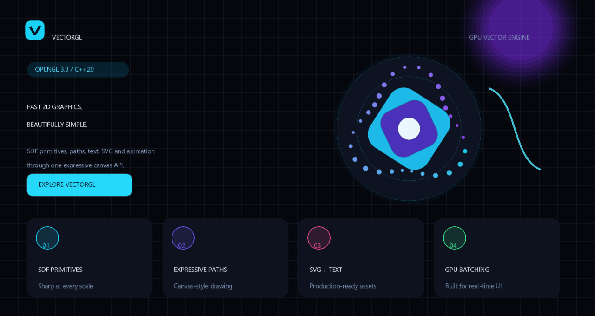

# VectorGL

[](https://github.com/mahtab04/vectorgl/actions/workflows/build.yml)
[](https://github.com/mahtab04/vectorgl/releases/latest)
[](./LICENSE)
[](https://en.cppreference.com/w/cpp/20)
[](https://www.khronos.org/opengl/)
[](https://deepwiki.com/mahtab04/vectorgl)

[Documentation](https://mahtab04.github.io/vectorgl-website/) ·
[Architecture](ARCHITECTURE.md) ·
[Examples](https://mahtab04.github.io/vectorgl-website/examples.html) ·
[API Reference](https://mahtab04.github.io/vectorgl-website/api.html) ·
[Guides](https://mahtab04.github.io/vectorgl-website/guides.html) ·
[Releases](https://github.com/mahtab04/vectorgl/releases)

> GPU-accelerated 2D vector graphics and application UI for C++20, built on OpenGL 3.3 Core.

[](example/showcase.cpp)

_The scene above is rendered in real time by the standalone
[`vectorgl_showcase`](example/showcase.cpp) example._

VectorGL provides three complementary APIs:

- **Canvas** — an immediate-mode, HTML5 Canvas-style drawing surface with SDF-accelerated shape primitives.
- **Scene** — a retained-mode scene graph with animations, effects, and hierarchical node composition.
- **UI** — a retained widget system with layouts, controls, focus and event routing, virtualized collections, and application workspaces.

Use Canvas for direct drawing, Scene for persistent visual objects, and UI for
interactive controls. Scene and UI paint through Canvas and can share the same
OpenGL frame. The GLFW adapter supplies host integration; native file-dialog
services support Windows and Linux applications.

It also includes an SVG loader, TrueType font rendering, and a post-processing effects pipeline (blur, shadow, glow).

---

## ✨ Features

| Feature | Description |
|---|---|
| **SDF Primitives** | Rectangles, circles, ellipses, and rounded rectangles rendered on the GPU via signed distance fields — hundreds of shapes in a single draw call. |
| **Path Rendering** | Lines, cubic/quadratic Bézier curves, arcs, and ellipses; nonzero/even-odd compound fills with holes, overlaps, and self-intersections. |
| **SVG Support** | Load and render SVG files via `SvgImage` (single file) or `SvgCache` (handle-based asset manager). |
| **Text Rendering** | Dynamic Unicode glyphs, font kerning, wrapping and alignment; FreeType-hinted small text with SDF rendering for larger/transformed text. |
| **Animation System** | Tween (22 easing curves), spring (critically-damped), and keyframe animations with loop/ping-pong modes. |
| **Post-Processing** | FBO-based Gaussian blur, drop shadows, and outer glow — composable via a fluent `EffectChain` API. |
| **Scene Graph** | Parent/child hierarchy with transform inheritance, dirty tracking, and z-index ordering. |
| **Paint System** | Solid colors, linear/radial gradients, and texture patterns. |
| **Nested Clipping** | Transformed rectangular and rounded clipping with intersection, reset, and automatic `save()` / `restore()` state. |
| **Application UI** | Row/column/grid layout, split panels, scrolling, text fields, numeric editors, menus, tabs, tooltips and modal dialogs. |
| **Collections and Interaction** | Virtualized lists, trees and tables with stable IDs, selection, keyboard navigation and typed in-process drag/drop. |
| **Host and Platform Services** | GLFW event/DPI integration, injectable clipboard and file-dialog services, and invalidation-driven painting. |

## Application UI

`vectorgl::ui` provides persistent controls, shared themes, layout, keyboard focus,
pointer capture, clipping-aware hit testing and modal input scopes. Routing and
layout work without an OpenGL context; painting uses an active Canvas frame.
The host forwards events explicitly, so UI can coexist with a separate Scene
artboard and application shortcuts.

Start with the [integrated workspace example](example/ui_editor_workspace_demo.cpp):
a searchable toolbox, Scene artboard, property inspector/hierarchy and 2,000-row
tag table. It demonstrates resizable panels, drag/drop, independent artboard zoom,
and Open/Save path selection. Document serialization remains application code.

```sh
cmake --preset workspace
cmake --build --preset workspace --target vectorgl_ui_editor_workspace
```

On Windows with Visual Studio, run
`build/workspace/example/Debug/vectorgl_ui_editor_workspace.exe`.
With Ninja on Linux, run `build/workspace/example/vectorgl_ui_editor_workspace`.
The example accepts `--font PATH`, `--width`, `--height` and `--screenshot FILE.bmp`.

| Area | Guide | Example target |
|---|---|---|
| Events, focus, capture and widget lifetime | [UI Context](docs/ui-context.md) | `vectorgl_ui_routing` |
| Painting, DPI and GLFW event forwarding | [Host integration](docs/ui-glfw.md) | `vectorgl_ui_host` |
| Measurement, row/column/grid and alignment | [Layout](docs/ui-layout.md) | `vectorgl_ui_layout` |
| Split panels, scrolling and focus reveal | [Containers](docs/ui-containers.md) | `vectorgl_ui_workspace` |
| Text fields, buttons, checkboxes and numeric editing | [Controls](docs/ui-controls.md) | `vectorgl_ui_controls` |
| ComboBox, menus, tooltips and modal dialogs | [Overlays](docs/ui-overlays.md) | `vectorgl_ui_controls` |
| Tabs, labels, collapsible sections and search | [Workspace controls](docs/ui-workspace-controls.md) | `vectorgl_ui_workspace` |
| Virtualized lists, hierarchy and table cells | [Lists](docs/ui-lists.md), [trees](docs/ui-trees.md), [tables](docs/ui-tables.md) | `vectorgl_ui_list`, `vectorgl_ui_tree`, `vectorgl_ui_table` |
| Typed drag/drop and Scene placement | [Drag/drop](docs/ui-drag-drop.md) | `vectorgl_ui_editor_workspace` |
| Queued native Open/Save path selection | [File dialogs](docs/ui-file-dialogs.md) | `vectorgl_ui_editor_workspace` |

Canvas/core, UI, the GLFW adapter and native dialogs build by default. Tests,
examples and apps remain disabled until explicitly requested; the `workspace`
preset enables the UI examples. Native dialog backends use Windows Common Item
Dialog or runtime-optional Linux Zenity. Use `core` for an explicit graphics-only
build, or `ci-headless` for UI tests without the GLFW adapter.

Text editing is currently left-to-right and Unicode-codepoint based. Shaping/bidi,
IME composition, grapheme-cluster editing and OS accessibility bridges remain
separate work. See the [migration guide](docs/ui-migration.md) for capability and
platform validation requirements.

## Color palette

`Color` includes expanded named colors, aliases, a suggested UI palette, constexpr
helpers, and explicit component clamping. Existing values and interpolation alpha
behavior are preserved. See the [color guide](docs/colors.md) and build
`vectorgl_palette` for the paged swatch and RGB/Oklab comparison example.

## Compound paths and fill rules

All contours in a path are filled together. `FillRule::NonZero` is the default:
oppositely directed inner contours create holes. `FillRule::EvenOdd` creates
holes regardless of contour direction. Open contours close implicitly for
filling; strokes keep their original geometry.

```cpp
canvas.beginPath();
canvas.moveTo(20, 20); canvas.lineTo(180, 20);
canvas.lineTo(180, 180); canvas.lineTo(20, 180); canvas.closePath();
canvas.moveTo(60, 60); canvas.lineTo(140, 60);
canvas.lineTo(140, 140); canvas.lineTo(60, 140); canvas.closePath();
canvas.fill(vectorgl::FillRule::EvenOdd); // Square with a hole
// Gradient fills accept the same rule:
canvas.fillWithPaint(gradient, 1.0f, vectorgl::FillRule::EvenOdd);

node->setFillRule(vectorgl::FillRule::EvenOdd); // Retained path rendering + picking
bool inside = path.contains(x, y, vectorgl::FillRule::EvenOdd); // Local coordinates
```

SVG `fill-rule="evenodd"` / `"nonzero"` works in presentation attributes,
stylesheets and inline styles, including group inheritance and gradient fills.
Translucent overlapping contours are filled once. Tessellation uses
[libtess2](https://github.com/memononen/libtess2), fetched by CMake from a pinned,
SHA-256-verified archive, and requires no stencil buffer
or extra package for installed consumers. Fill coordinates must be finite and
within +/-8388608; rendering rejects invalid paths and `contains()` returns false.

The first configure downloads libtess2 into the build directory. For offline
builds, reuse populated dependencies or pass
`-DFETCHCONTENT_SOURCE_DIR_VECTORGL_LIBTESS2=/path/to/libtess2`.

This replaces the previous independent filling of each contour. Existing paths
with opposite contour directions can now have holes under the default rule.

Run [`vectorgl_fill_rules`](example/fill_rules_demo.cpp) to compare rings,
overlapping translucent rectangles, and self-intersecting stars side by side.
Press **Space** to reverse the inner ring; hover to check filled regions.
Use `--font path/to/font.ttf` if a system font is unavailable.

## Stroke joins and caps

Path strokes support `LineJoin::Miter`, `Round`, and `Bevel`, plus
`LineCap::Butt`, `Round`, and `Square`. Miter joins fall back to bevel when the
join center-to-tip distance divided by the half-width exceeds the miter limit. Canvas and
scene paths default to miter joins, butt caps, and a limit of 10.

```cpp
canvas.setLineWidth(20);
canvas.setLineJoin(vectorgl::LineJoin::Round);
canvas.setLineCap(vectorgl::LineCap::Square);
canvas.setMiterLimit(4);
canvas.beginPath();
canvas.moveTo(20, 80); canvas.lineTo(60, 80); canvas.lineTo(60, 40);
canvas.stroke();

node->setStrokeStyle({vectorgl::LineJoin::Bevel, vectorgl::LineCap::Round, 4});
bool hit = path.strokeContains(x, y, 20,
    {vectorgl::LineJoin::Round, vectorgl::LineCap::Round, 4});
```

Stroke settings participate in Canvas `save()` / `restore()`. Joins also apply
to `strokeRect()`; scene stroke styling applies to path and line nodes. Other
SDF primitives retain their existing analytic outlines. Widths and geometry are
in local coordinates, then transformed by the full affine transform. Round
boundaries use bounded curve sampling. Nonfinite path stroke inputs are rejected and miter
limits must be at least 1. Nonpositive widths produce no path stroke.

Open endpoints receive caps; `closePath()` connects the endpoints with a join.
Returning to the start with `lineTo()` keeps an open path. Explicit zero-length
lines or closed zero-length subpaths paint round/square dots, while butt caps and move-only contours paint
nothing. Strokes are unioned before drawing, so translucent overlaps do not
darken. Scene picking tests the same sampled mesh, excluding antialias fringes.
Each path caches its most recent stroke width/style alongside its fill meshes.

SVG presentation attributes, CSS, inline styles and inheritance support
`stroke-linejoin`, `stroke-linecap` and `stroke-miterlimit` (SVG defaults to a
miter limit of 4).

Run [`vectorgl_strokes`](example/strokes_demo.cpp) for a side-by-side comparison.
Use **Up/Down** for width, **Left/Right** for miter limit, and hover to test picking.
The example accepts `--font path/to/font.ttf` and `--smoke-test`.

Compatibility: path segments now connect with miter joins by default, replacing
the previous independent segment rectangles. Stroke corners can extend farther.
`Canvas::strokeRect()` now uses path geometry to honor joins; use the existing
SDF shape APIs when batching analytic primitive outlines is the priority.

## Dashed strokes

```cpp
canvas.setLineDash({12, 6});       // Alternating dash/gap lengths, local units
canvas.setLineDashOffset(-4);     // Signed distance into the repeating pattern
canvas.stroke();

vectorgl::StrokeStyle style;
style.cap = vectorgl::LineCap::Round;
style.dashArray = {0, 18};        // Dots with round caps
style.dashOffset = offset;
node->setStrokeStyle(style);     // Scene path/line rendering and picking
```

Odd-length lists repeat twice to form an even pattern; empty and all-zero lists
draw solid strokes. Dash lengths must be finite and nonnegative, and offsets
must be finite. Canvas setters preserve the existing style on invalid input.
Dash settings participate in `save()` / `restore()` and reset with `beginFrame()`.

Patterns restart at each subpath and continue across its flattened curve/line
segments. A dash spanning a corner retains the selected join. Visible runs
crossing a closed path's seam join there, with caps at the true dash endpoints.
Round and square caps can extend into the nominal gap. Picking tests the same
mesh, so these painted extensions are selectable too. The cached stroke key
includes the pattern and offset; animating offsets rebuilds that mesh while
retaining the contours. GPU draw calls are not added per dash.

Canvas `strokeRect`, `strokeCircle`, `strokeEllipse`, and `strokeRoundedRect`
honor dashes; curved primitives use their sampled path route only while dashing
is active. Scene dash styling applies to path/line nodes. SVG presentation
attributes, CSS and inheritance support `stroke-dasharray` / `stroke-dashoffset`
using numbers in user units or `px`; `none` removes the pattern. Percentages,
other length units and `pathLength` calibration are not supported.

Dash processing is limited to 65,536 interval steps per stroke (including gaps,
zero entries and phase initialization). Excessive density throws `std::length_error`
when rendering; `strokeContains()` returns false. The limit bounds generated
work without imposing a minimum dash length.

Run [`vectorgl_dashes`](example/dashes_demo.cpp) for dashed connectors, dotted
curves and an animated marching-ants selection. **Space** pauses, **Left/Right**
adjusts offsets, and **Up/Down** changes animation speed. Hover dashes and gaps
to check picking. `--screenshot preview.bmp` captures the first rendered frame;
`--smoke-test` runs three hidden frames.

## Flow Studio desktop app

[Flow Studio](apps/diagram_editor/README.md) is a complete local diagram workspace
built with VectorGL: task/decision/note cards, editable properties, connections,
multi-selection, card copy/cut/paste, alignment, pan/zoom, undo/redo, JSON save/load,
SVG export, a minimap and
light/dark themes, recent files, remembered workspace settings and recovery
snapshots. Windows includes native file dialogs and unsaved-change prompts.

Build the `flow_studio` target (`VECTORGL_BUILD_APPS=ON`) and run
`build/windows-debug/apps/diagram_editor/Debug/flow_studio.exe`. See the app guide
for controls, platform behavior and document limits.

## Large scenes and rendering statistics

Build and run [`vectorgl_large_scene`](example/large_scene_demo.cpp) to explore
10,000 tiles and 16 text labels. Drag to pan, use the wheel to zoom, press **C**
to toggle viewport culling, **L** to clear scene layouts each frame, and **R**
to reset. Pass `--font path/to/font.ttf` to choose a font. The HUD reports CPU
scene submission time, draw calls, streamed buffer bytes, culled nodes and
layout cache hits/misses. CPU submission time excludes presentation and does
not measure GPU execution time. The HUD's own drawing is excluded from these
scene measurements.

```cpp
scene.render();                    // Within an active Canvas frame
canvas.renderer().flush();         // Include pending batches in counters
const auto stats = canvas.renderer().frameStats();
canvas.renderer().setViewportCulling(false); // Compare against the baseline
```

Counters reset at `beginFrame()` and remain available after `endFrame()`.
Draw calls include clipping masks and effects; upload bytes count streamed
vertex/instance buffers, excluding glyph/image texture uploads. Rendered nodes
means submissions retained after culling, including missing-resource nodes.

Unchanged scene paths retain local contours and a fill mesh for each rule.
Changing transforms, opacity, or colors reuses geometry; editing the path
discards its derived cache. Copies may share caches until edited. Picking and
Canvas path commands reuse contour arrays; Canvas fills still tessellate their
submitted contours. `pathTessellations` and `pathMeshCacheHits` count renderer
work per frame, excluding cache work performed by CPU picking. GPU uploads and
draw calls still happen each frame. At most two fill meshes and the latest stroke
mesh are retained per cached path geometry, with storage proportional to complexity. Synchronize access
when using paths or copies sharing a lazy cache across threads.

Scene SDF shapes and images are conservatively culled against the framebuffer,
including transformed quad bounds and SDF stroke/antialias padding. Text,
paths, effect-bearing nodes, and nonfinite/unsupported bounds are retained.
Culling does not affect picking or direct Canvas primitive draws. Scene render
lists reuse their allocation, but rebuild and sort each frame to observe edits.

Canvas and scene text drawing share an immutable layout cache owned by each
font: at most 32 entries and 2 MiB of accounted text/layout storage. Keys include
text, wrapping width/mode, alignment and line spacing. Layout metrics stay
independent of transforms and bitmap/SDF mode; reload/destroy invalidates the
cache. Oversized inputs/layouts are computed without retention. Call
`font.layoutCacheStats()` or `font.clearLayoutCache()` to inspect/reset it.
`cachedLayoutText()` returns shared immutable layouts; externally retained
layouts survive eviction and are outside the cache budget. Allocator bookkeeping
is outside the accounted byte limit. Font caches require external synchronization
if accessed from multiple threads.

---

## 📋 Requirements

| Requirement | Minimum Version |
|---|---|
| C++ Standard | C++20 |
| Compiler | MSVC 2022, GCC 12+, or Clang 15+ |
| CMake | 3.21+ (4.2+ for VS 2026) |
| GPU | OpenGL 3.3 capable; 8-bit stencil buffer for rounded clipping |

The default GLFW adapter requires platform development packages on Linux.
See [prerequisites and build profiles](CONTRIBUTING.md). Missing source dependencies
are fetched at pinned revisions; system/offline inputs are also supported.

---

## 🔧 Dependencies

| Dependency | Version / revision | Purpose |
|---|---|---|
| [GLFW](https://www.glfw.org/) | 3.3.8 | Default host adapter; window/context management for apps and examples |
| [glad](https://github.com/Dav1dde/glad) | 2.0.8 | Vendored OpenGL 3.3 loader; no generation step needed |
| [stb](https://github.com/nothings/stb) | `31c1ad3` | Image decoding, font metrics and SDF glyph rasterization |
| [FreeType](https://freetype.org/) | 2.14.3 bundled, or a system provider | Hinted grayscale coverage for small text |
| [libtess2](https://github.com/memononen/libtess2) | `8dbd648` | Compound-path tessellation and fill rules |

VectorGL's own targets are static libraries. Dependencies may be shared when
provided by a parent project or system package. See [dependency configuration](CONTRIBUTING.md#dependencies-and-offline-builds).

---

## 🏗️ Building

For prerequisites, troubleshooting, and contribution steps,
see [Building and Contributing](CONTRIBUTING.md).

Build all library modules with tests, examples and apps disabled:

```sh
cmake --preset library
cmake --build --preset library
```

To enable and run CPU tests, choose the developer profile:

```sh
cmake --preset developer
cmake --build --preset developer
ctest --preset developer
```

- `library`: Canvas/core, UI, GLFW adapter and native dialogs; no tests, examples or apps.
- `core`: explicit graphics-only SDK with UI disabled.
- `developer`: all library modules and CPU tests.
- `ui`: UI/host/dialog modules and CPU tests.
- `workspace`: UI examples, GLFW adapter and native dialogs.
- `full`: all examples, Flow Studio, tests and GPU smoke checks.

Release profiles include `core-release`, `library-release`, `workspace-release` and `full-release`.
Linux also has `sanitizers` and `quality`. Existing Windows/Linux/MinGW presets
remain available. Generic presets let CMake choose the generator; select Ninja or
MinGW explicitly when using those toolchains. Visual Studio 2022/2026 discovery
is preserved.

The helpers select the available toolchain and use these same profiles:

```bat
scripts\build.bat -Profile workspace
```

```sh
./scripts/build.sh --profile workspace
```

For the showcase, configure `full`, then build target `vectorgl_showcase`. For the
UI workspace, build `vectorgl_ui_editor_workspace` from `workspace`. Visual Studio
executables are under `build/<preset>/example/Debug/`; Ninja executables are under
`build/<preset>/example/`.

Fresh FetchContent and direct CMake builds provide Canvas, UI, the GLFW adapter
and native dialogs automatically.
Tests, examples and apps stay disabled until explicitly enabled.
Developer checks are opt-in. Library tests, app tests, examples and applications
are independently controlled. See [the build guide](CONTRIBUTING.md) for options,
offline/system dependencies, test labels and compiler setup.

The [release workflow](.github/workflows/release.yml) builds core/full static SDK
archives with compiler/platform metadata and checksums. Full SDKs include UI,
host and dialog components. External consumers verify each archive after extraction
and relocation, before publication to [Releases](https://github.com/mahtab04/vectorgl/releases).

---

## 🚀 Quick Start

### Immediate-Mode Canvas

```cpp
#include <vectorgl/canvas.hpp>

// After creating an OpenGL 3.3 context:
vectorgl::Canvas canvas;
canvas.init();

// Each frame:
canvas.beginFrame(fbWidth, fbHeight);

canvas.setFillColor(vectorgl::Color::hex(0x3366FF));
canvas.fillRoundedRect(50, 50, 300, 200, 12);

canvas.setStrokeColor(vectorgl::Color::White);
canvas.setLineWidth(2.0f);
canvas.strokeCircle(400, 150, 60);

canvas.beginPath();
canvas.moveTo(500, 50);
canvas.bezierCurveTo(550, 0, 650, 100, 700, 50);
canvas.stroke();

canvas.endFrame();
```

### Retained-Mode Scene Graph

```cpp
#include <vectorgl/canvas.hpp>
#include <vectorgl/scene.hpp>

vectorgl::Scene scene(canvas.renderer());

auto rect = scene.roundedRect(100, 100, 200, 150, 8);
rect->setFill(vectorgl::Color::Blue);
rect->setShadow(8.0f, {4, 4}, vectorgl::Color{0, 0, 0, 0.3f});

// Animate
vectorgl::AnimTarget from, to;
from.x = 100; from.mask = vectorgl::AnimTarget::PosX;
to.x   = 500; to.mask   = vectorgl::AnimTarget::PosX;

scene.animator().emplace<vectorgl::TweenAnimation>(
    rect->id(), from, to, 2.0f, vectorgl::Ease::OutCubic);

// Each frame:
scene.update(dt);
scene.render();
```

### Application UI controls

Create controls once and keep their Context alive for their lifetime:

```cpp
#include <vectorgl/ui/context.hpp>
#include <vectorgl/ui/controls.hpp>

vectorgl::ui::Context ui;
auto theme = ui.theme();
theme.fontPath = fontPath; // Application-selected TrueType font.
ui.setTheme(theme);

vectorgl::ui::ButtonOptions options;
options.label = "Save";
options.onActivated = [] { /* Save the application's document. */ };
vectorgl::ui::Button saveButton(ui, {}, options);
ui.setBounds(saveButton.id(), {20, 20, 140, 44});

// When the host supplies an input event:
ui.dispatch(event);

// During an active Canvas frame, using the host's logical/framebuffer sizes:
vectorgl::ui::Viewport viewport(logicalWidth, logicalHeight, fbWidth, fbHeight);
ui.paint(canvas, viewport);
```

Link `vectorgl::ui`, or `vectorgl::glfw` when using the adapter. The
[host example](example/ui_host_demo.cpp) supplies a complete event loop, coordinate
mapping and callback lifetime management. The UI does not initialize OpenGL or
install application window callbacks implicitly.

### Scene Hit Testing

Use `Scene::pick(x, y)` to select the topmost painted shape in framebuffer
coordinates. It refreshes transforms without advancing animations and needs no
OpenGL context:

```cpp
if (auto node = scene.pick(mouseX, mouseY)) {
    node->setFill(vectorgl::Color::Red);
}
```

Picking supports rectangles, rounded rectangles, circles, ellipses, lines and
simple paths, with parent transforms, visibility, opacity, fills and strokes.
Higher z-index wins; ties follow draw order. Empty outline interiors do not hit.
Path subpaths are filled independently, matching the current renderer. Effects,
antialias fringes and renderer clipping are excluded. Text uses logical layout
bounds, including spaces and gaps between lines; images use their full rectangle,
including transparent pixels. Both support the full parent affine transform.

The [interactive example](example/hit_testing_demo.cpp) demonstrates selection,
dragging, a rotated parent group, outlines, and overlapping shapes. Build the
`vectorgl_hit_testing` target and run it from your build's `example` directory
(the `Debug` subdirectory for Visual Studio). Click/drag to move, Up/Down to
change z-index, R to reset, and Esc to close. Convert GLFW window cursor units to
framebuffer pixels on high-DPI displays, as shown in the example.

### Scene Text and Images

```cpp
#include <vectorgl/font.hpp>
#include <vectorgl/image.hpp>

auto font = std::make_shared<vectorgl::Font>();
auto image = std::make_shared<vectorgl::Image>();
if (!font->load("font.ttf", 22) || !image->load("photo.png")) {
    // Handle missing assets before adding content.
    return;
}
vectorgl::TextLayoutOptions options;
options.maxWidth = 320;
options.align = vectorgl::TextAlign::Center;
auto label = scene.text("Unicode text", 40, 60, font, options);
label->setFill(vectorgl::Color::White);
auto picture = scene.image(image, 40, 180, 320, 180);
picture->setOpacity(0.8f);
```

Text positions address the top-left layout origin. The loaded font sets the em
size; `setTextLayout()` controls wrapping, alignment and line spacing. Update
content with `setText()` or replace the shared font with `setFont()`.
`textLayout()` measures without GL calls. `setSize()` does not resize text;
load a different font size or use `setScale()`. Text uses fill color and ignores
stroke. Pixel snapping defaults on and can be disabled with `setTextPixelSnap(false)`.

The image factory takes top-left coordinates, then stores a centered rectangle,
like `rect()`. Later `setPosition()` moves its center. Zero width/height use the
image's natural dimensions; positive dimensions stretch it. `setImage()` changes
the resource. Fill/stroke colors do not tint images; node opacity multiplies
source alpha. Null or unloaded resources produce no rendering or hit.

Nodes share ownership of fonts/images. Keep their GL context current when loading
or releasing resources. Queued scene text retains its font until the glyph batch
is flushed; explicitly flush the renderer before reloading or destroying a font
in place. Parent transforms and visibility apply, while opacity remains a property
of each individual node. Both `render()` overloads refresh transforms without
advancing animations; `update(dt)` advances animations.

Build and run `vectorgl_scene_content` for the
[scene text/image example](example/scene_content_demo.cpp). Click/drag text or images,
Up/Down changes order, O toggles opacity, R resets, and Esc closes. The example
shares one image between two nodes, includes a rotated parent group, and handles
high-DPI cursor coordinates. Pass `--font path/to/font.ttf` to choose a font.

### SVG Rendering

```cpp
#include <vectorgl/svg.hpp>

vectorgl::SvgImage svg;
svg.load("icon.svg");
svg.render(canvas, 10.0f, 10.0f, 64.0f, 64.0f);
```

### Text Input & UI Widgets

Font atlases use a least recently used cache, limited to 16 entries by default.
Applications can tune or clear it:

```cpp
canvas.setFontCacheLimit(8);
canvas.clearFontCache(); // flushes pending text before releasing its atlases
```

Font loading returns `false` for unsupported files or sizes outside `(0, 256]`.
Unicode glyphs are rasterized on demand into up to four 1024x1024 R8 pages per
font, with a maximum of 4096 distinct cached glyphs. Font-file bytes remain in
memory for dynamic rasterization and kerning. Atlas pages keep stable UVs;
missing glyphs or a full cache draw the replacement glyph while retaining the
original font advance. Consecutive glyphs sharing a page are batched, with drawing order
preserved across shapes, images, clipping, and effects. Low-level callers must
keep an atlas alive until `renderer.flush()` or the end of the frame.

Font sizes specify the em square in pixels; line height follows the font's
ascent/descent/gap metrics and may be larger than the requested size.
`fillText()` and `measureText()` share UTF-8 decoding and font kerning. The `y`
coordinate is the top of the line; the baseline is `y + font ascent`. Explicit
line breaks are supported, and measurement returns the widest line. Add layout
options for wrapping, alignment, and line spacing:

```cpp
vectorgl::TextLayoutOptions options;
options.maxWidth = 320;
options.wrap = vectorgl::TextWrap::Word; // None or Character are also available
options.align = vectorgl::TextAlign::Center; // Left or Right
options.lineSpacing = 1.25f;
canvas.fillText(utf8Text, 40, 100, options);
auto layout = canvas.layoutText(utf8Text, options); // no texture uploads or GL calls
// layout.width/height, lines, glyph positions, and UTF-8 caret byte boundaries
```

Word wrapping breaks at whitespace and falls back to codepoint breaks for long
words. Tabs advance by four spaces. `setTextPixelSnap(false)` enables fractional
line origins; by default whole lines snap in framebuffer space, preserving
fractional glyph advances. SDF coverage uses a one-pixel antialias band.

Small, snapped, axis-aligned text uses FreeType light-hinted grayscale coverage
by default at 1-24 framebuffer pixels per em. Larger text, rotation, reflection,
shear, nonuniform scaling, and disabled pixel snapping use SDF. Uniform DPI
scaling is included when choosing the raster size. Layout, kerning, wrapping
and caret positions stay the same in both modes.

```cpp
// Set after beginFrame(); save()/restore() preserves this setting.
canvas.setTextRenderingMode(vectorgl::TextRenderingMode::Auto); // default
canvas.setTextRenderingMode(vectorgl::TextRenderingMode::Sdf);  // always SDF
canvas.setTextRenderingMode(vectorgl::TextRenderingMode::Bitmap);
label->setTextRenderingMode(vectorgl::TextRenderingMode::Bitmap); // scene text
```

`Bitmap` permits hinted coverage up to 64 framebuffer pixels per em for supported
transforms; other transforms and unavailable coverage fall back to SDF. It rounds
the raster em size and baseline to device pixels, with quarter-pixel horizontal
phases to preserve fractional spacing. This is grayscale coverage, not LCD or
Windows ClearType. All sizes/phases share the font's existing four-page,
4096-entry cache limit; pages and UVs stay stable until font reload/destruction.

By default FreeType 2.14.3 is fetched at configure time, built statically, and
installed with VectorGL and its license notices. A system provider is also supported. Use `-DVECTORGL_ENABLE_HINTED_TEXT=OFF` for the
original SDF-only build; bitmap requests then fall back to SDF. Offline builds can supply a populated source directory or installed dependency;
see [offline builds](CONTRIBUTING.md#dependencies-and-offline-builds).

The [small-text comparison example](example/text_raster_demo.cpp),
`vectorgl_text_raster`, compares SDF, hinted bitmap and Auto at 12-32 px and
1x/1.5x/2x framebuffer scales. F2 toggles pixel snapping; F3 switches the editable
16 px Unicode field's mode. It supports `--font path/to/font.ttf` and
`--smoke-test --screenshot preview.bmp`.

This software uses the FreeType library under the FreeType License (FTL).
Portions of this software are copyright (C) 2026 The FreeType Project
(https://freetype.org). All rights reserved.

`TextBox` accepts Unicode typing and clipboard input. Arrow keys, selection,
Backspace/Delete, scrolling, and pointer placement preserve UTF-8 codepoints.
Selection indices are UTF-8 byte offsets; malformed input becomes U+FFFD and
single-line controls are removed. Layout is left-to-right and does not include
complex-script shaping, bidi, font fallback stacks, color emoji, IME composition,
or grapheme-cluster editing (combining marks and emoji sequences remain separate
codepoints).

The [text layout example](example/text_layout_demo.cpp) shows Unicode input,
kerning, wrapped left/center/right columns, small and transformed text, and a
sharp-versus-blur comparison. Run `vectorgl_text_layout` from your build's
`example/Debug` directory on Visual Studio, or `example` with a single-config
generator. It discovers a system font, or accepts `--font path/to/font.ttf`.
F2 toggles pixel snapping. `--smoke-test --screenshot preview.bmp` saves a hidden
preview and exits. The blur pass now flushes queued glyphs, uses the correct
vertex layout and UV orientation, and preserves opacity through filtering.

Animation time steps must be finite and non-negative. Looping animations wrap
time without repeatedly subtracting their duration, and tween/keyframe masks
support position, size, rotation, scale, opacity, fill, and stroke color.

The older standalone text-input example uses lightweight helpers from
`vectorgl/ui.hpp`. For new application interfaces, prefer the routed controls in
`vectorgl/ui/controls.hpp` and the [UI examples](#application-ui). The legacy helper
and routed-control headers define overlapping class names and should not be
included together in the same translation unit.

The standalone example demonstrates:

- `vectorgl::TextBox` — single-line text editing
- `vectorgl::GlfwTextBoxController` — forwards GLFW input events
- `vectorgl::ui::Label` / `vectorgl::ui::Button` — simple text and button elements

```cpp
#include <vectorgl/canvas.hpp>
#include <vectorgl/glfw_text_box.hpp>
#include <vectorgl/ui.hpp>

AppState app;
app.canvas.init();
app.field.setBounds(40.0f, 140.0f, 460.0f, 52.0f);
app.field.setFont(fontPath, 24.0f);
app.field.setPlaceholder("Type here");

app.button.setBounds(530.0f, 140.0f, 160.0f, 52.0f);
app.button.setText("Load Sample");

app.textInput.bind(app.field, app.canvas, window);
```

> 💡 The full working sample lives in `example/text_input_demo.cpp` — use it for the complete version with styling, hover state, selection, clipboard shortcuts, and status text.

---

## 📁 Project Structure

```text
vectorgl/
├── CMakeLists.txt                 # Build orchestration and default modules
├── CMakePresets.json              # Library, developer, workspace and CI profiles
├── cmake/                        # Options, dependencies, tooling and SDK exports
├── include/
│   ├── PublicHeaders/vectorgl/    # Canvas, Scene, text, SVG and other public APIs
│   │   └── ui/                   # Context, layout, controls, collections and hosts
│   └── InternalHeaders/          # Implementation helpers
├── src/
│   ├── CMakeLists.txt            # Core renderer target
│   ├── svg/                      # SVG parser and rendering modules
│   └── ui/                       # UI, GLFW adapter and native dialog targets
├── shaders/                      # GLSL sources, embedded during configuration
├── third_party/glad/             # Vendored OpenGL loader and license
├── example/                      # Runnable graphics and UI examples
├── apps/diagram_editor/          # Flow Studio application
├── tests/                        # Engine/UI/GPU and external-consumer checks
├── scripts/                      # Local builds, CI and SDK verification
└── docs/                         # Technical Markdown guides
```

---

## 🔌 Integration

All four targets are built by default. Link the targets your application uses:

| CMake target | Provides | Transitive VectorGL dependencies |
|---|---|---|
| `vectorgl::vectorgl` | Canvas, Scene, text, SVG, images and effects | None |
| `vectorgl::ui` | Routed controls, layout, collections and UI Context | Core |
| `vectorgl::glfw` | GLFW events, DPI metrics, clipboard and cursor adapter | UI and core |
| `vectorgl::dialogs` | Windows/Linux native file-dialog backends | UI and core |

### Via `find_package` (installed SDK)

```cmake
find_package(vectorgl CONFIG REQUIRED COMPONENTS ui glfw dialogs)
target_link_libraries(myapp PRIVATE vectorgl::glfw vectorgl::dialogs)
```

For drawing only, omit `COMPONENTS` and link `vectorgl::vectorgl`. Installed SDKs
import UI/host/dialog targets only when the corresponding components are requested.
A core-only SDK does not provide those components.

### Via `add_subdirectory`

```cmake
add_subdirectory(vectorgl)
target_link_libraries(myapp PRIVATE vectorgl::glfw vectorgl::dialogs)
```

### Via `FetchContent`

```cmake
include(FetchContent)

FetchContent_Declare(vectorgl
    GIT_REPOSITORY https://github.com/mahtab04/vectorgl.git
    GIT_TAG        22975c2e4a252e196c19616028f390e6d2fee3ab # Pin a reviewed revision.
)
FetchContent_MakeAvailable(vectorgl)

target_link_libraries(myapp PRIVATE vectorgl::glfw vectorgl::dialogs)
```

No module-enable flags are needed. Replace the pinned revision when deliberately
updating the dependency. Tests, examples and apps are not built unless enabled.
Applications provide the window/GL context, event loop and document persistence.

---

## 📖 Documentation

The complete documentation is published as a browsable site:

- [Documentation home](https://mahtab04.github.io/vectorgl-website/)
- [Overview and architecture](https://mahtab04.github.io/vectorgl-website/overview.html)
- [Usage guides](https://mahtab04.github.io/vectorgl-website/guides.html)
- [API reference](https://mahtab04.github.io/vectorgl-website/api.html)
- [Example gallery](https://mahtab04.github.io/vectorgl-website/examples.html)

The website source and deployment live in
[`vectorgl-website`](https://github.com/mahtab04/vectorgl-website). Technical
Markdown guides remain in [`docs/`](./docs). This repository only deploys small
redirect pages to preserve the old website URLs.

---

## ✅ Build and test status

The [Build and Test workflow](https://github.com/mahtab04/vectorgl/actions/workflows/build.yml)
is configured to cover:

- Linux GCC Debug/Release and headless AddressSanitizer/UndefinedBehaviorSanitizer checks.
- Windows MSVC and MinGW GCC, each in Debug and Release.
- Linux GPU, graphics/UI example and Flow Studio smoke tests with Mesa/Xvfb.
- Clang 18 static analysis and first-party formatting.
- Core-only SDKs, default FetchContent embedding, and installed component consumers.

The badge links to actual workflow results. Linux/Windows desktop dialog behavior
requires separate interactive validation; mocked service tests do not establish
desktop parity.

Version tags matching the project version (`v<version>`) run the release pipeline;
publication waits for the package checks. Manual workflow dispatch builds artifacts
without publishing a release. See [Releases](https://github.com/mahtab04/vectorgl/releases).

---

## 📄 License

See [LICENSE](./LICENSE) for details.
