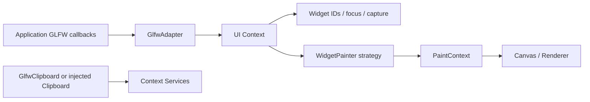

# Widget painting and GLFW host integration

The optional UI layer supports fixed local rectangles, affine transforms,
polymorphic painting, shared themes, and host-independent input. The optional
`vectorgl::glfw` target translates events and exposes clipboard/cursor services.
See [automatic layout](ui-layout.md) for row/column/grid strategies. The richer
control catalog remains future work.

## Responsibilities and ownership



Context owns registrations, callback storage, focus, and capture. A Widget holds a
shared painter strategy; a derived painter can also implement its input method,
which the registration's `onEvent` callback forwards to. Context remains the sole
focus/capture authority. `SurfacePainter` provides a basic themed fill and focus
outline; it does not implement button activation behavior.
Use `SurfacePainter(SurfaceRole::Panel)` for passive containers so their fill stays
steady when the pointer crosses child widgets. The default Control role retains
localized hover feedback. Both roles keep keyboard focus outlines.

Painters receive ephemeral `PaintContext` data: local bounds, enabled/focus/hover
state, Theme, and Canvas. The Canvas already contains the widget-to-framebuffer
transform and inherited clips. A painter may draw custom content without knowing
the host window. `PaintContext::fillRect()` uses a path for accurate affine fills.
Custom sheared shapes should use Canvas paths as well; analytic SDF primitives
retain their existing transform limitations.

## Transforms, hit testing, and clipping

`Widget::transform` composes with every ancestor transform. Bounds describe local
geometry; their x/y values do not translate the coordinate origin for children.
Use a translated parent transform to build a local panel coordinate system:

```cpp
Widget panel;
panel.bounds = {0, 0, 360, 240};
panel.transform = Mat3x3::translation(30, 120);
panel.clipChildren = true;
panel.painter = std::make_shared<SurfacePainter>(SurfaceRole::Panel);
auto panelId = ui.add(panel);

Widget item;
item.parent = panelId;
item.bounds = {16, 24, 200, 40}; // Maps to root position 46,144.
item.focusable = true;
item.painter = std::make_shared<SurfacePainter>();
auto itemId = ui.add(item);
```

Identity transforms preserve the original fixed-rectangle routing example.
`setTransform()` rejects nonfinite/projective matrices. Singular transforms and
their subtrees are skipped by painting, hit testing, focus, and capture. Making a
captured subtree singular cancels it. `mapFromRoot()` returns an optional local
point; `hitTest()` applies every ancestor clip. `Event::x/y` stay in root logical
coordinates; `localX/localY` are recomputed for each pointer-event recipient,
including bubbling and captured movement outside the original rectangle.

Paint order is parent before children, then subsequent siblings. Modal subtrees
are painted last in modal stack order, once per subtree, with ancestor clips
preserved. Modal input remains restricted to the active scope.

Axis-aligned rectangular clips use a scissor. Rotated/sheared clips use exact
sharp rectangular stencil masks. Supply a stencil attachment with at least 8 bits
for these clips; painting throws when it is missing, with Canvas state restored.
Depth is subject to the renderer's existing 255-mask limit. Rounded/custom widget
hit regions are outside this slice's rectangular hit contract.

## Logical coordinates and framebuffer pixels

`Viewport(logicalWidth, logicalHeight, framebufferWidth, framebufferHeight)` defines
independent X/Y ratios for painting. Begin a Canvas frame using those framebuffer
dimensions, then call `ui.paint(canvas, viewport)` inside it. Context does not begin
or end the frame, clear the background, or bind a framebuffer, allowing embedded
rendering into an existing target.

`WindowMetrics` additionally distinguishes GLFW screen coordinates and content
scale. Its policy defines one logical unit as one framebuffer pixel at content
scale 1:

```text
logicalWidth  = framebufferWidth / contentScaleX
logicalHeight = framebufferHeight / contentScaleY
logicalX = cursorWindowX * framebufferWidth / windowWidth / contentScaleX
logicalY = cursorWindowY * framebufferHeight / windowHeight / contentScaleY
```

This handles both a 1:1 window/framebuffer with fractional desktop scale and a
Retina-style framebuffer larger than the window coordinates. Content scale is
applied once. Zero-sized/minimized windows return no Viewport or mapped point;
skip painting until positive sizes return. Artboard zoom should be a separate
widget transform, leaving desktop scale unchanged.
The example requests GLFW's scale-to-monitor window hint so its initial window
extent follows monitor scale on platforms where GLFW supports that policy.

## Host adapter and service lifetimes

```cpp
// GLFW initialized, window created, GL context and Canvas initialized by the app.
Context ui(Services{{}, std::make_shared<GlfwClipboard>(window)});
GlfwAdapter host(window, ui);
// Destroy host, UI assets, and Canvas before destroying the window/GL context.
```

GlfwAdapter installs no callbacks, changes no window user pointer, and runs no
event loop. Forward cursor position, mouse buttons, both wheel axes, key actions,
characters, focus, and cursor enter/leave from the application's callbacks. The
adapter returns consumed status so the host can offer unconsumed input to its
application commands. Call `refreshMetrics()` on window-size, framebuffer-size,
and content-scale notifications. Catch exceptions at every native callback boundary.
The complete example demonstrates forwarding and scoped callback teardown.

Keys map to the Context's semantic key set, including press/repeat/release.
Unmapped keys return unconsumed for application handling. Characters are committed
Unicode scalars encoded to UTF-8; this is not an IME preedit bridge. Scroll events
retain GLFW's line-based X/Y offsets. Leaving the window or losing focus cancels
capture through the Context's existing cancellation contract.

`GlfwClipboard` explicitly opts into native clipboard use. Inject a fake provider
for tests. Read/write report Success/Unavailable/Error; embedded NUL writes fail
before native access. These operations consume GLFW's thread-local error status;
they install no global error callback. Cut clients must successfully write selected
text before deleting it. The example smoke test injects memory storage and preserves
the user's clipboard.

`setCursor()` lazily owns standard GLFW cursors and returns service status.
Destroying the adapter releases only its cursor objects; GLFW resets windows still
using those objects. Calls and destruction belong to GLFW's main thread. Window
and Context must outlive the adapter; window must also outlive clipboard clients.

## Frame scheduling and failure handling

Paint only when dirty or when the host requires a refresh. Consume dirty flags before
painting so invalidations raised by painters remain pending for the next frame.
Check `pendingInvalidation()` before waiting; wait until input or `nextWakeup()`.
Call `pumpTimers()` when a deadline arrives. The host example forwards resize/refresh
notifications and sleeps with GLFW event waiting while idle.

Painting scopes Canvas style, transform, and clipping state, including exception
paths. Paths and selected fonts follow normal Canvas semantics and are not restored
by save/restore. Painters must keep frame lifecycle and save/restore balanced.
Painter exceptions settle deferred removal/capture cancellation and propagate to
the host. Reentrant dispatch or painting from a painter is rejected. New registrations
are published after the paint transaction and appear on the next paint.

## Build, install, and examples

```sh
cmake -S . -B build-ui-host -DVECTORGL_BUILD_UI=ON -DVECTORGL_BUILD_GLFW_ADAPTER=ON -DVECTORGL_BUILD_UI_EXAMPLES=ON -DVECTORGL_BUILD_EXAMPLES=OFF -DVECTORGL_BUILD_APPS=OFF
cmake --build build-ui-host --config Debug --target vectorgl_ui_host
```

`vectorgl_ui_host` accepts `--font PATH`, `--smoke-test`, and `--screenshot FILE.bmp`.
Without a font argument it tries Segoe UI on Windows and DejaVu Sans on Linux.
It demonstrates text editing/selection and fake/native clipboard services, focus,
palette changes, transformed clips and an event-driven loop. The original
`vectorgl_ui_routing` headless example remains available.

`VECTORGL_BUILD_GLFW_ADAPTER` defaults OFF and requires UI ON. UI without the adapter
does not fetch GLFW. When the adapter fetches pinned GLFW, it installs GLFW's
target, headers, package files and license alongside VectorGL. If the application
supplies GLFW, it must also supply a discoverable installed GLFW package.

```cmake
find_package(vectorgl CONFIG REQUIRED COMPONENTS glfw) # Also imports UI.
target_link_libraries(my_editor PRIVATE vectorgl::glfw)
```

Base and `ui` component discovery do not resolve GLFW. The `glfw` component calls
`find_dependency(glfw3 3.3 CONFIG)`. Graphics-only builds keep both modules OFF.
Linux host builds need GLFW's platform development packages; headless UI tests remain
independent of X11/Wayland. Optional [native dialog services](ui-file-dialogs.md)
are available separately through `vectorgl::dialogs`.

Forward iconification with `adapter.iconified(iconified != 0)` in addition to
focus callbacks. Iconification and nondrawable framebuffer transitions cancel
capture/drag state and clear focus. `nativeDialogOwner()` returns a Windows HWND
as `uintptr_t` (zero elsewhere) for parenting the optional file chooser. Install
`FileDialogService::setHostEventDrain([] { glfwPollEvents(); })` so queued input is
consumed while the temporary native-dialog modal barrier is still active. Pump
file requests outside UI callbacks, and avoid waiting for new events while work
is already queued. The integrated workspace demonstrates this host loop.

## Design references

The coordinate separation follows GLFW's official [window guide](https://www.glfw.org/docs/3.3/window_guide.html)
and event translation follows its [input guide](https://www.glfw.org/docs/3.3/input_guide.html).
Qt Quick's [item-to-scene mapping contract](https://doc.qt.io/qt-6/qquickitem.html#mapFromScene)
is a reference for inverse-transform hit mapping. These informed the design;
VectorGL adds no Qt dependency and uses its own implementation.
